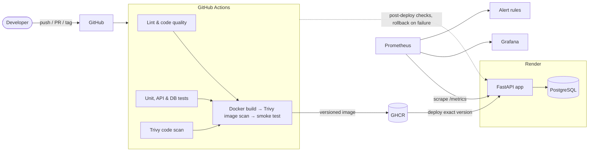

# Task Management API: DevOps CI/CD Project

[](https://github.com/pranamya07/devops_mini/actions/workflows/ci-cd.yml)

A REST API for managing tasks, built with **FastAPI** and **PostgreSQL**. Every change goes
through an automated pipeline:

- linting
- automated tests
- Trivy security scans
- a versioned Docker image in GitHub Container Registry
- deployment to **Render**
- post-deployment checks, with **automatic rollback** if they fail

**Prometheus** and **Grafana** monitor traffic, errors, latency, CPU and memory.

- **Live API:** https://devops-mini-sxph.onrender.com (the free plan sleeps when idle, so the first request can take about a minute)
- **API docs (Swagger):** https://devops-mini-sxph.onrender.com/docs

## Architecture



The full set of diagrams (pipeline, Docker, database, monitoring, release flow) is in
[docs/architecture.md](docs/architecture.md).

## What's included

| Area | What it does | Where |
|---|---|---|
| Application | Task CRUD with input validation; Swagger at `/docs`; `/health` checks the database | [app/](app/) |
| Database | PostgreSQL via SQLAlchemy; data persists across container restarts | [app/models.py](app/models.py), [compose.yaml](compose.yaml) |
| Containers | Docker image runs as non-root (UID 10001), with a health check and OS security patches; Compose runs API + PostgreSQL + Prometheus + Grafana | [Dockerfile](Dockerfile), [compose.yaml](compose.yaml) |
| Testing | 159 tests (unit, API, database), 97% coverage, alert-rule tests, container smoke test | [tests/](tests/), [docs/testing.md](docs/testing.md) |
| CI/CD | Lint → tests → Trivy → build → scan → smoke test → versioned image → GHCR → Render → post-deploy checks | [.github/workflows/ci-cd.yml](.github/workflows/ci-cd.yml) |
| Security | Trivy image and code scans block fixable HIGH/CRITICAL issues; secrets only in GitHub Secrets | [docs/security.md](docs/security.md) |
| Monitoring | Prometheus metrics, a 13-panel Grafana dashboard, 4 alert rules | [monitoring/](monitoring/), [docs/monitoring.md](docs/monitoring.md) |
| Logging | Timestamped, levelled logs; request IDs; errors on a separate stream; log rotation | [app/logging_config.py](app/logging_config.py) |
| Versioning & rollback | `git tag v1.2.0` releases that version; failed releases roll back automatically | [docs/release-and-rollback.md](docs/release-and-rollback.md) |

## Quick start (Docker Compose)

You need Docker Desktop.

```bash
git clone https://github.com/pranamya07/devops_mini.git
cd devops_mini
cp .env.example .env          # then set POSTGRES_PASSWORD in .env
docker compose up -d --build
```

| Service | URL |
|---|---|
| API docs (Swagger) | http://localhost:8000/docs |
| Grafana dashboard | http://localhost:3000 (opens on "Task API - Overview", no login needed to view) |
| Prometheus | http://localhost:9090 (alerts at `/alerts`) |

Try it out:

```bash
# Create a task
curl -X POST localhost:8000/api/v1/tasks -H 'content-type: application/json' \
     -d '{"title": "Write report", "priority": "high"}'

# Restart the containers. The task is still there afterwards.
docker compose restart api db
curl localhost:8000/api/v1/tasks

# Send traffic so the Grafana dashboard has data
python3 scripts/generate_traffic.py --duration 120
```

To stop everything, run `docker compose down`. Data is kept in Docker volumes; add `-v` to delete it.
If a port is already in use, set `API_PORT`, `GRAFANA_PORT` or `PROMETHEUS_PORT` in `.env`.

## Running without Docker

```bash
python3 -m venv .venv && source .venv/bin/activate
pip install -r requirements-dev.txt
uvicorn app.main:app --reload     # uses a local SQLite file unless DATABASE_URL is set
pytest                            # all tests, with a coverage report
```

## API endpoints

| Method | Endpoint | Description |
|---|---|---|
| POST | `/api/v1/tasks` | Create a task (returns `201` and a `Location` header) |
| GET | `/api/v1/tasks` | List tasks; filter with `status`, `priority`; paginate with `limit` (1–100), `offset` |
| GET | `/api/v1/tasks/{id}` | Get one task (`404` if missing) |
| PUT | `/api/v1/tasks/{id}` | Replace a task |
| PATCH | `/api/v1/tasks/{id}` | Update only the fields sent |
| DELETE | `/api/v1/tasks/{id}` | Delete a task (`204`) |
| GET | `/health` | `200` if the API and database are up, `503` if the database is unreachable |
| GET | `/api/v1/deployment-info` | App name, environment and **running version** |
| GET | `/metrics` | Prometheus metrics |
| GET | `/docs` | Swagger UI |

A task has:

| Field | Required | Rules |
|---|---|---|
| `title` | yes | 1–200 characters; surrounding spaces are trimmed |
| `description` | no | up to 1000 characters |
| `status` | no | `todo` (default), `in_progress` or `done` |
| `priority` | no | `low`, `medium` (default) or `high` |
| `due_date` | no | a date, such as `2026-12-31` |

Unknown fields and invalid values are rejected with `422`. If the database is down, the API
returns `503` instead of crashing.

## CI/CD pipeline

| Trigger | What runs |
|---|---|
| Pull request to `dev` / `main` | Lint, tests (on PostgreSQL), Trivy scans, Docker build, image scan, smoke test. Nothing is published. |
| Push to `dev` / `main` | All of the above, then pushes the image to GHCR as `dev`/`main` and `sha-<commit>` |
| Tag `v1.2.0` | All of the above, plus images `1.2.0`, `1.2` and `latest`, then **deploys to Render**, verifies the live site and rolls back if the checks fail |
| Manual "Rollback Production" | Deploys an earlier version and verifies it |

The pipeline fails, and nothing is published, if:
- any test fails, or coverage drops below 90%
- linting fails
- Trivy finds a fixable HIGH or CRITICAL vulnerability, a leaked secret or a Dockerfile misconfiguration
- the container smoke test fails

## Configuration

| Variable | Default | Used for |
|---|---|---|
| `DATABASE_URL` | SQLite file `./tasks.db` | Database connection. Compose and Render set it to PostgreSQL. |
| `APP_NAME` | `Task Management API` | Shown in `/` and `/api/v1/deployment-info` |
| `APP_ENV` | `development` | `production` on Render |
| `APP_VERSION` | `1.0.0` | Set by CI from the release tag and baked into the image |
| `LOG_LEVEL` | `INFO` | `DEBUG`, `INFO`, `WARNING` or `ERROR` |
| `POSTGRES_PASSWORD` | (none, required) | Compose's PostgreSQL password, set in `.env` |
| `GRAFANA_ADMIN_PASSWORD` | `admin` | Grafana admin login (local only) |

Secrets go in `.env` (which git ignores) or in GitHub Secrets, never in the code.

## Project structure

```text
devops_mini/
├── app/
│   ├── main.py              # FastAPI app, health, metrics, error handling
│   ├── routers/tasks.py     # /api/v1/tasks endpoints
│   ├── schemas.py           # request/response validation (Pydantic)
│   ├── models.py            # database table (SQLAlchemy)
│   ├── crud.py              # database operations
│   ├── database.py          # engine, sessions, connectivity check
│   ├── config.py            # settings from environment variables
│   ├── observability.py     # Prometheus metrics + request logging middleware
│   ├── logging_config.py    # log format, levels, stdout/stderr split
│   └── healthcheck.py       # Docker HEALTHCHECK command
├── tests/
│   ├── unit/                # no database or HTTP (58 tests)
│   ├── api/                 # HTTP tests via TestClient (88 tests)
│   └── db/                  # database layer (13 tests)
├── monitoring/
│   ├── prometheus/          # scrape config, alert rules, alert-rule tests
│   └── grafana/             # data source + dashboard, loaded automatically
├── scripts/
│   ├── smoke_test.sh            # container test: health, non-root, data survives restart
│   ├── verify_deployment.py     # post-deployment checks on the live site
│   ├── render_deploy.sh         # deploy one exact image version to Render
│   ├── last_good_release.sh     # pick the rollback target
│   ├── generate_traffic.py      # load generator for the dashboard
│   └── test_summary.py          # test results table for the CI run page
├── docs/                    # architecture, testing, security, monitoring, release guides
├── .github/workflows/
│   ├── ci-cd.yml            # main pipeline
│   └── rollback.yml         # manual rollback
├── Dockerfile
├── compose.yaml
├── render.yaml              # Render Blueprint (web service + PostgreSQL)
├── pyproject.toml           # pytest, coverage and Ruff settings
├── requirements.txt
└── requirements-dev.txt
```

## Documentation

- [Architecture](docs/architecture.md): system, CI/CD, Docker, database and monitoring diagrams
- [Testing](docs/testing.md): test strategy, what each suite covers, latest results
- [Security](docs/security.md): Trivy scanning, container hardening, secrets handling
- [Monitoring and logging](docs/monitoring.md): metrics, dashboard, alerts, logs
- [Releases and rollback](docs/release-and-rollback.md): setup, releasing, the rollback demo
- [Evidence checklist](docs/evidence-checklist.md): screenshots and results for the project report
