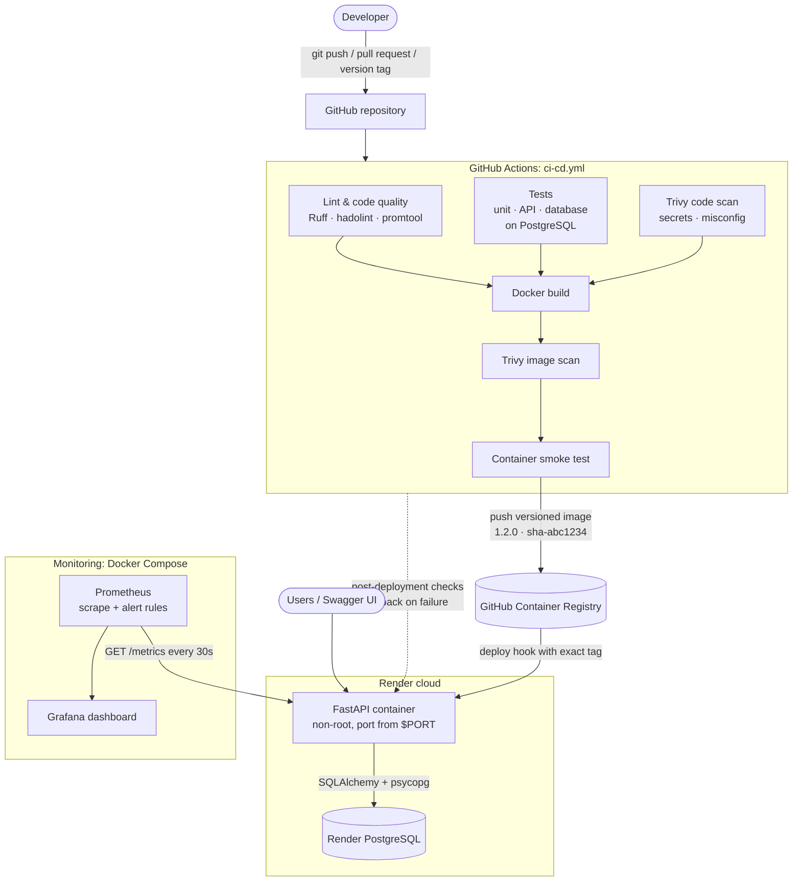
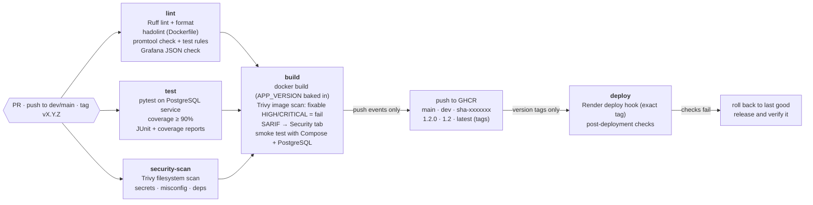
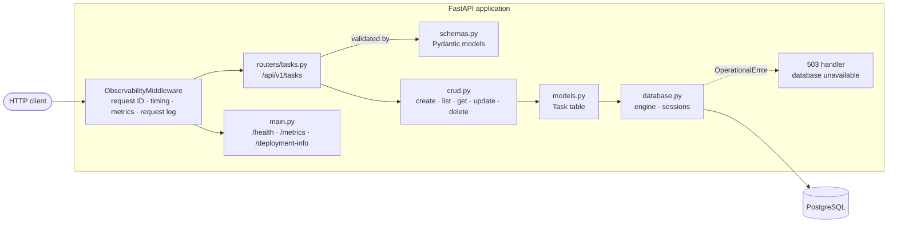
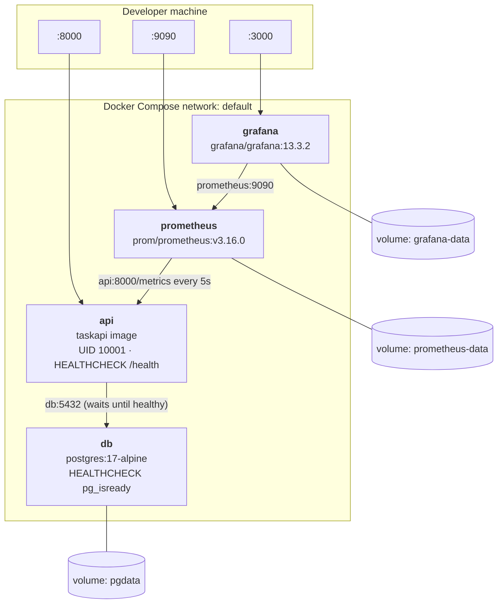
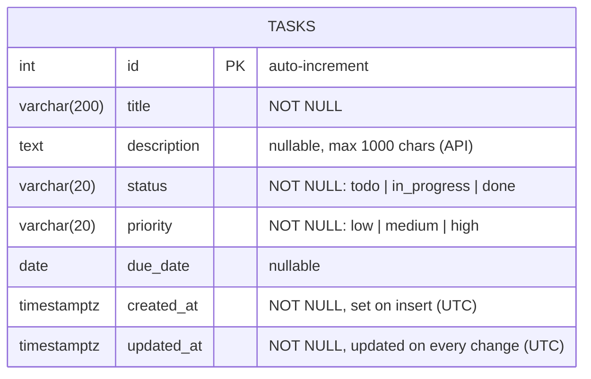
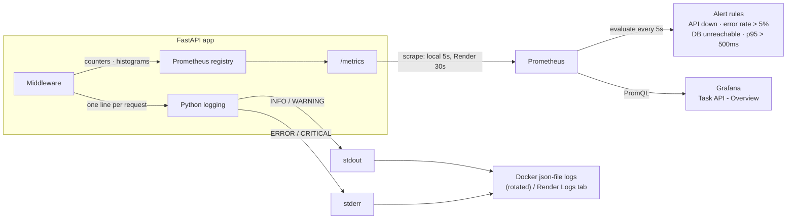
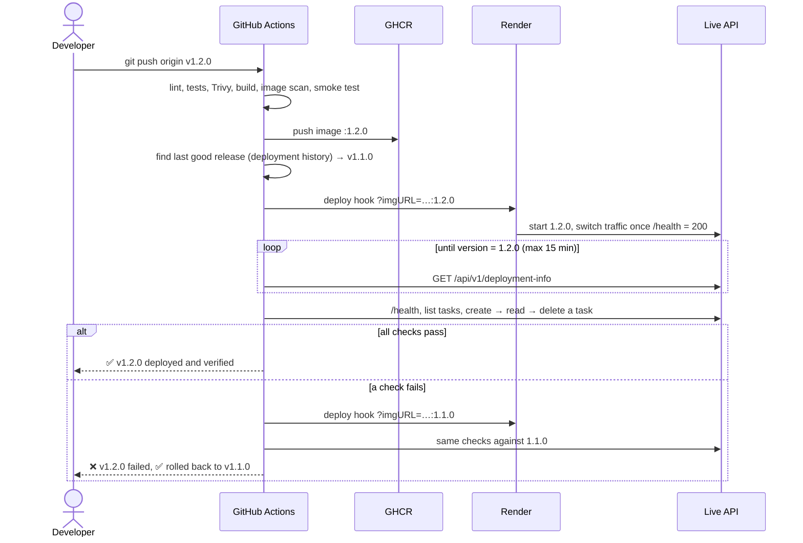

# Architecture

1. [System architecture](#1-system-architecture)
2. [CI/CD pipeline](#2-cicd-pipeline)
3. [Application architecture](#3-application-architecture)
4. [Docker architecture](#4-docker-architecture)
5. [Database architecture](#5-database-architecture)
6. [Monitoring and logging architecture](#6-monitoring-and-logging-architecture)
7. [Release and rollback flow](#7-release-and-rollback-flow)

## 1. System architecture

| Component | Technology | Runs on |
|---|---|---|
| API | Python 3.12, FastAPI, Uvicorn | Render (production), Docker Compose (local) |
| Database | PostgreSQL 17 | Render PostgreSQL (production), `postgres:17-alpine` container (local, CI) |
| Image registry | GitHub Container Registry (GHCR) | GitHub |
| CI/CD | GitHub Actions | GitHub-hosted Ubuntu runners |
| Security scanning | Trivy, hadolint, Ruff security rules | CI |
| Monitoring | Prometheus, Grafana | Docker Compose |

## 2. CI/CD pipeline

| Job | Fails the pipeline when |
|---|---|
| `lint` | Ruff finds a lint or format issue; hadolint flags the Dockerfile; Prometheus config or alert-rule tests fail; dashboard JSON is invalid |
| `test` | Any test fails, or coverage falls below 90% |
| `security-scan` | Trivy finds a secret, a HIGH/CRITICAL misconfiguration, or a fixable HIGH/CRITICAL dependency issue |
| `build` | The image doesn't build; Trivy finds a fixable HIGH/CRITICAL vulnerability in the image; the smoke test fails |
| `deploy` | The new version doesn't go live, or the live checks fail (it rolls back first, then fails) |

Each job shows its results on the run page: a test results table, a coverage table, the
Trivy findings, image tags and a release summary. Test and Trivy reports can be downloaded
as run artifacts.

## 3. Application architecture

| Module | Responsibility |
|---|---|
| `main.py` | Creates the app, startup (create tables, log version), `/health`, `/metrics`, the database-error handler |
| `routers/tasks.py` | The six task endpoints; returns 404 for missing tasks; counts task operations |
| `schemas.py` | Validation rules: lengths, allowed values, unknown fields rejected, nulls only where allowed |
| `crud.py` | All database reads and writes |
| `models.py` | The `tasks` table definition |
| `database.py` | Connection pool (with `pool_pre_ping`, so dead connections are replaced after a database restart) |
| `config.py` | Settings from environment variables; converts Render's `postgres://` URLs for SQLAlchemy |
| `observability.py` | Prometheus metrics and one log line per request |
| `logging_config.py` | Log format with UTC timestamps; INFO/WARNING to stdout, ERROR to stderr |
| `healthcheck.py` | Used by Docker `HEALTHCHECK`, because the slim image has no curl |

## 4. Docker architecture

**The API image** (`Dockerfile`), in build order:

1. `python:3.12-slim` (Debian 13)
2. `apt-get upgrade`, to apply Debian security fixes published since the base image was built
3. Create user `app`, UID/GID 10001
4. Install `requirements.txt`, then **remove pip** (not needed at runtime)
5. Copy `app/` only. Tests, scripts, docs and `.env` are excluded by `.dockerignore`.
6. `USER 10001:10001`, `HEALTHCHECK` every 30 seconds, run `uvicorn` on `$PORT` (Render sets it; 8000 by default)

`APP_VERSION` is a build argument, so each image reports its own release version.

**Volumes:** the database is stored in the named volume `pgdata`. Restarting or recreating
containers keeps the data; only `docker compose down -v` deletes it.

**Logging:** every container uses the `json-file` driver with rotation (10 MB × 3 files).

## 5. Database architecture

| Topic | How it works |
|---|---|
| Access | SQLAlchemy 2.0 ORM with the psycopg 3 driver; one session per request, closed afterwards |
| Schema creation | Tables are created at startup if missing (`create_all`) |
| Enums | Stored as readable text (`in_progress`), with the allowed values enforced by the API |
| Connection URL | `DATABASE_URL`. Render's `postgres://…` form is converted to `postgresql+psycopg://…`. |
| Resilience | `pool_pre_ping` replaces broken connections; if the database is unreachable, endpoints return `503` and `/health` reports `unreachable` |
| Persistence | Local: Docker volume `pgdata`. Production: Render's managed PostgreSQL. |
| Environments | Local runs without Docker use SQLite; Compose, CI and Render use PostgreSQL 17 |

**Known limitation (and the rollback demo):** `create_all` creates missing tables, but it
never changes existing ones. A release that adds a column passes CI, because CI starts from an
empty database, but fails in production. The post-deployment checks catch exactly this, and
the [rollback demo](release-and-rollback.md#demo-a-failed-release-that-rolls-itself-back)
shows it happening. A migration tool such as Alembic would be the next step.

## 6. Monitoring and logging architecture

Details: [monitoring.md](monitoring.md).

## 7. Release and rollback flow

Setup and the demo script: [release-and-rollback.md](release-and-rollback.md).
